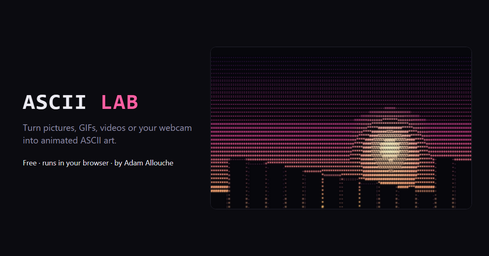

# ASCII Lab

**Turn pictures, GIFs, videos or your webcam into colored, animated ASCII art.** 
Free, no account, and nothing is uploaded: everything runs in your browser.

**[Open ASCII Lab →](https://ascii-lab-adam.vercel.app)**

## What you can do

- **Pictures** (PNG, JPG, WebP…): still ASCII, or with an effect.
- **GIFs:** every frame becomes ASCII and keeps playing (Chrome and Edge; Firefox can't decode GIF frames yet).
- **Videos** (MP4, WebM): converted live while they play.
- **Webcam:** see yourself as live ASCII. The camera never leaves your device.
- **Characters:** classic `.:-=+*#%@`, fine, blocks `░▒▓█`, dots, katakana (Matrix), binary, or your own.
- **Colors:** the picture's real colors, one tint, or a two-color gradient; background, glow, invert.
- **Effects:** still, shimmer, glitch, decode, rain, breathe.
- **Save:** PNG, animated SVG (works in GitHub READMEs), or a WebM video of the animation.

## How it works

1. The picture is shrunk to one pixel per character (the "Detail" slider sets how many characters wide).
2. Each pixel's brightness picks a character from the set, from light to dense.
3. Its color comes from the picture, a tint or a gradient.
4. Every frame is redrawn on a canvas; effects only change which character or color is drawn, or where.

It's a single `index.html`: no build step, no libraries, no server.

## Run it yourself

Download `index.html` and open it in your browser. That's it.

## Made by

**Adam Allouche** · [GitHub](https://github.com/Allouche-Adam) · [buy me a coffee](https://buymeacoffee.com/thock)

Use only pictures and videos you have the right to use when you share the results.

[MIT license](LICENSE)
